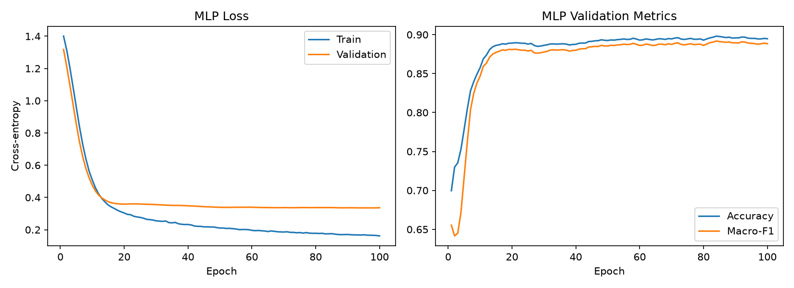
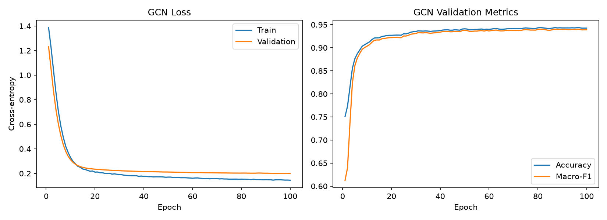
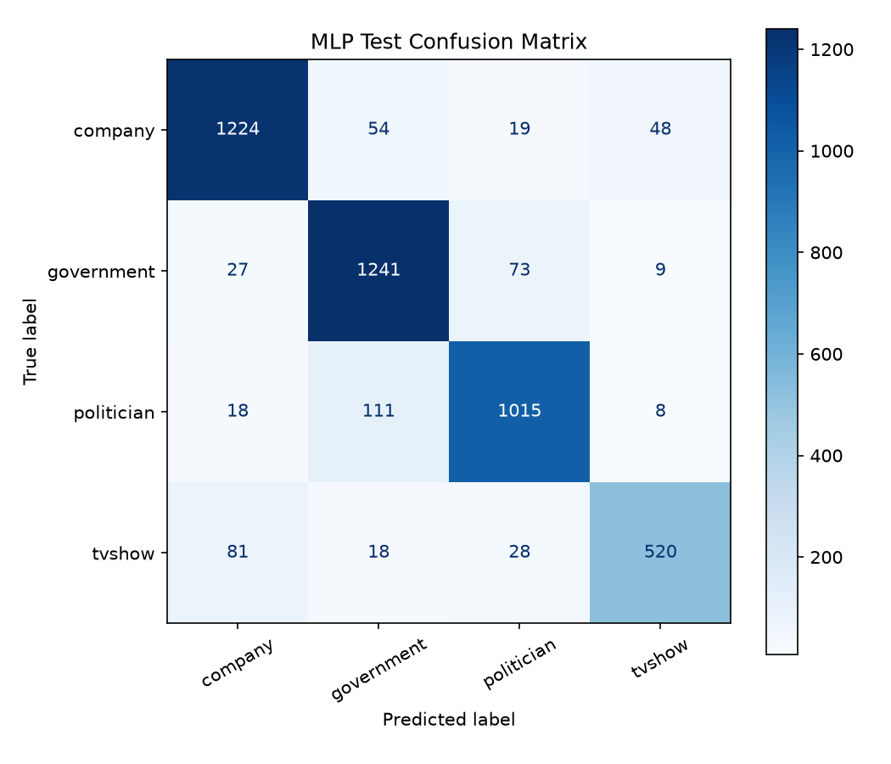
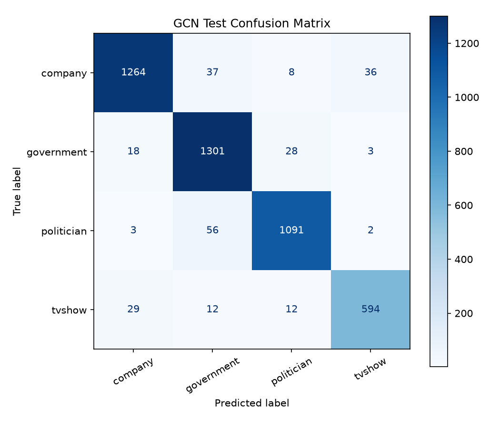
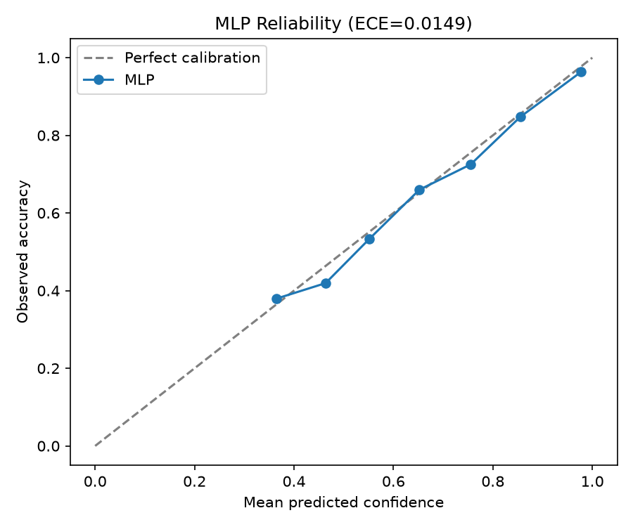
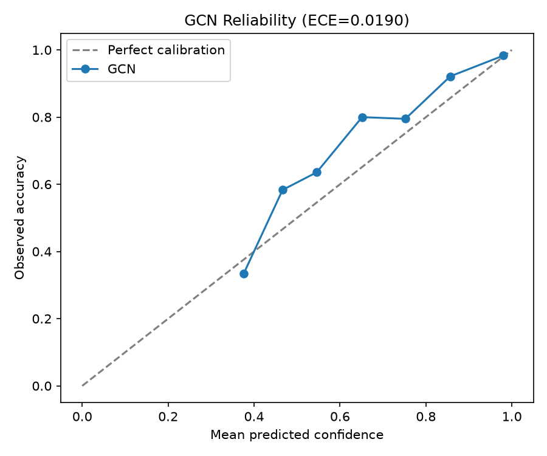
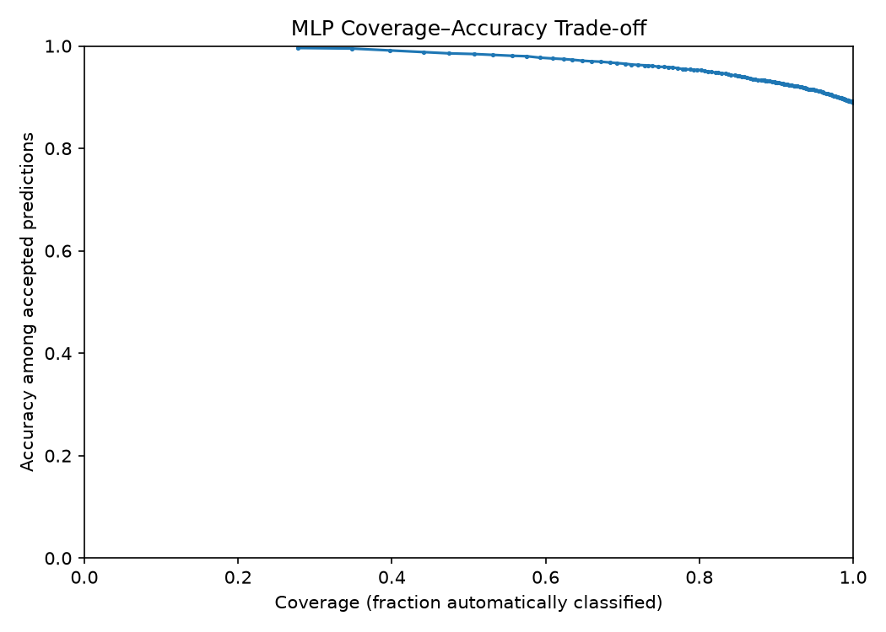
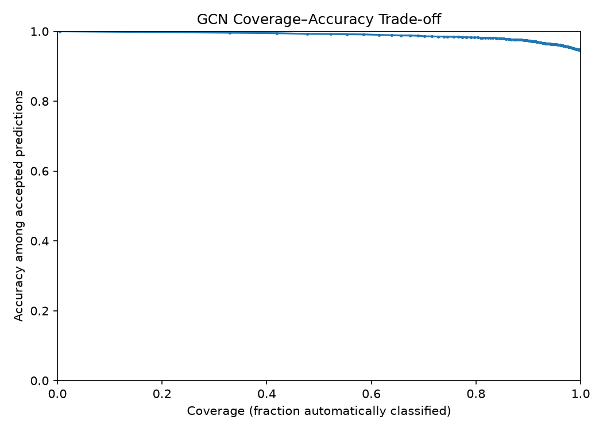
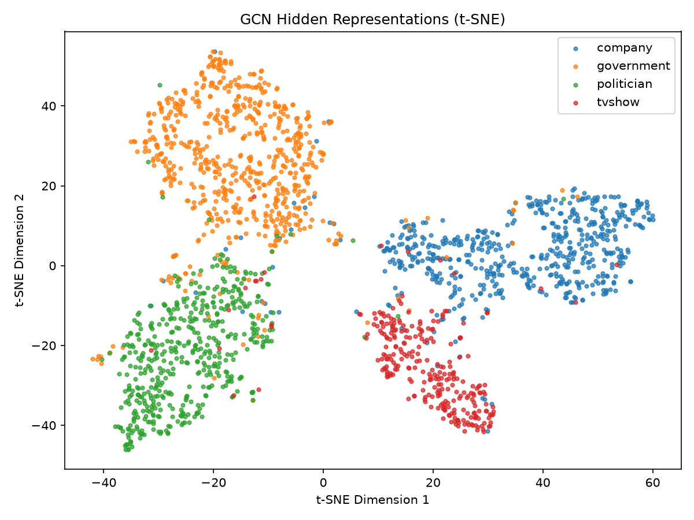

# Facebook Page Classification Using Graph Neural Networks

**COMP3710 Pattern Recognition | Normal Difficulty**

## 1. Project Overview

This project investigates the use of Graph Neural Networks (GNNs) to classify Facebook pages into four categories: company, government, politician, and TV show.

Unlike traditional classifiers, which rely only on the features of an individual page, Graph Neural Networks can also use information from connected pages. This is particularly useful for social networks, where pages with similar characteristics often share connections.

A two-layer Graph Convolutional Network (GCN) is implemented using PyTorch Geometric and compared against a Multi-Layer Perceptron (MLP) baseline. Both models use the same node features and training, validation, and testing splits, allowing the effect of graph structure on classification performance to be investigated.

### 1.1 Research Question

The central question is whether the GCN's improved classification performance also produces more reliable predictions.

A model may achieve high accuracy while remaining overconfident when it makes mistakes. This becomes important when uncertain predictions need to be referred for human review rather than automatically accepted.

The project therefore investigates:

1. Whether graph connectivity improves classification performance compared with a feature-only baseline.
2. Whether predicted confidence corresponds to actual correctness.
3. Whether confidence thresholds can identify predictions that should be referred for review.
4. Which graph structures and node characteristics contribute to classification failures.
5. Whether the improvement in performance justifies the additional computational cost.

### 1.2 Project Scope

The implementation uses the Facebook Large Page-Page Network dataset, containing 22,470 nodes and four classification categories.

The selected model is a two-layer GCN with 64 hidden units, ReLU activation, and dropout. A feature-only MLP serves as the baseline.

The project evaluates classification accuracy, macro-F1, AUROC, confidence calibration, error cases, learned node embeddings, and computational efficiency.


## 2. Feasibility Review

The following feasibility review was presented during the compulsory project consultation and approved for progression.

### 2.1 User Need, Scope and Acceptance Criteria

The project aims to develop a classification assistant that categorises Facebook pages into four classes: government, company, politician and TV show.

The proposed acceptance criteria are:

1. Compare the GCN against an MLP baseline using accuracy, macro-F1, precision, recall and AUROC.
2. Evaluate whether prediction confidence correlates with actual correctness.
3. Investigate representative misclassifications to identify possible sources of error.
4. Produce a t-SNE or UMAP visualisation of learned node representations.
5. Measure model parameter count, inference latency and memory usage.

### 2.2 Model Choice and Course Concepts

The selected architecture is a two-layer Graph Convolutional Network (GCN), following the semi-supervised graph convolution framework proposed by Kipf and Welling [1].

The GCN combines individual node features with information aggregated from neighbouring nodes. A feature-only Multi-Layer Perceptron (MLP) provides the baseline for evaluating the contribution of graph connectivity.

The proposed architecture consists of:

- Two graph convolution layers.
- A hidden layer containing 64 units.
- ReLU activation and dropout.
- Four output classes corresponding to the Facebook page categories.

The relevant course concepts include supervised learning, neural networks, graph convolution, cross-entropy optimisation, classification evaluation, uncertainty estimation and data leakage prevention.

### 2.3 Preliminary Feasibility Evidence

The preliminary data-loading implementation successfully processed the Facebook Large Page-Page Network dataset obtained from the UCI Machine Learning Repository [3].

The initial data audit established:

| Property | Result |
|---|---|
| Nodes | 22,470 |
| Undirected edges | 171,002 |
| Bidirectional edge entries | 342,004 |
| Raw node features | 4,714 |
| Classification categories | 4 |
| Training nodes | 13,482 |
| Validation nodes | 4,494 |
| Testing nodes | 4,494 |

The train/validation/test split follows a reproducible 60/20/20 allocation using a fixed random seed.

PyTorch and PyTorch Geometric were successfully installed and tested on a Mac with Apple MPS acceleration.

**Dataset compatibility consideration:** The assessment specification describes a 128-dimensional feature representation, whereas the accessible UCI dataset provides 4,714 raw binary features. This difference was identified in the feasibility review as requiring approval or an appropriate fallback. The implemented experiments use the raw feature representation, and this distinction is retained in the final methodology.

### 2.4 Risks, Computing Budget and Fallback

The initial feasibility review identified several potential risks:

- Dataset feature incompatibility between the supplied specification and available UCI data.
- Class imbalance affecting aggregate classification performance.
- Label leakage during graph-based message passing.
- Overconfident predictions on ambiguous or incorrectly classified nodes.
- Computational limitations when training and evaluating graph models.

The proposed computing strategy was to begin with a compact, two-layer GCN using local CPU or Apple MPS resources, then measure actual training time and memory requirements.

The next planned experiment was to train the GCN and MLP on identical data splits and compare their validation macro-F1 and confidence reliability.

If the raw features proved unsuitable, the proposed fallback was to obtain the prescribed 128-dimensional features or seek approval for raw features with documented dimensionality reduction.

### 2.5 Feasibility Review References

[1] Kipf, T. N., & Welling, M. (2017). Semi-Supervised Classification with Graph Convolutional Networks. ICLR. https://arxiv.org/abs/1609.02907

[2] Rozemberczki, B., Allen, C., & Sarkar, R. (2021). Multi-scale attributed node embedding. Journal of Complex Networks, 9(2). https://doi.org/10.1093/comnet/cnab014

[3] UCI Machine Learning Repository. Facebook Large Page-Page Network. https://archive.ics.uci.edu/dataset/527/facebook+large+page+page+network


## 3. Dataset and Preprocessing

### 3.1 Dataset Description

The project uses the Facebook Large Page-Page Network dataset from the UCI Machine Learning Repository [3]. Each node represents a Facebook page, while an edge represents a mutual like relationship between two pages.

The dataset contains four page categories:

- Company
- Government
- Politician
- TV show

The graph contains 22,470 nodes and 171,002 undirected edges. Each page also has a set of descriptive features, which are used alongside graph connectivity to predict its category.

### 3.2 Feature Preprocessing

The dataset is loaded from three files:

- `musae_facebook_edges.csv`: Connections between Facebook pages.
- `musae_facebook_target.csv`: Node IDs and their classification labels.
- `musae_facebook_features.json`: Feature identifiers associated with each node.

The original node IDs are mapped to consecutive tensor indices, ensuring that the feature matrix, labels and graph edges refer to the same nodes.

A binary feature matrix is constructed with 4,714 columns. Each entry is set to 1 when a page contains the corresponding feature and 0 otherwise.

This produces a node-feature matrix of shape:

`[22470, 4714]`

The four page categories are encoded as integer labels from 0 to 3.

The assignment specification describes a 128-dimensional feature representation. However, this implementation uses the 4,714-dimensional raw features available in the UCI dataset, as identified in the feasibility review.

No dimensionality reduction or feature normalisation is applied.

### 3.3 Graph Construction

The dataset represents an undirected Facebook network.

After mapping the original node identifiers to tensor indices, each edge is stored in both directions so it can be processed by PyTorch Geometric.

The resulting edge tensor has shape:

`[2, 342004]`

The first row contains source indices, while the second contains destination indices.

This bidirectional representation allows information to propagate between connected pages during graph convolution.

### 3.4 Training, Validation and Test Splits

A fixed random seed of 42 is used to generate reproducible node splits.

| Split | Percentage | Nodes |
|---|---:|---:|
| Training | 60% | 13,482 |
| Validation | 20% | 4,494 |
| Testing | 20% | 4,494 |
| **Total** | **100%** | **22,470** |

The splits are represented using Boolean masks:

- `train_mask`
- `val_mask`
- `test_mask`

These masks determine which nodes contribute to training, validation and final testing.

Both the GCN and MLP use the same splits to ensure a fair comparison.

### 3.5 Transductive Learning and Leakage Prevention

The GCN operates in a transductive learning setting.

The complete graph structure and node features are available during training, including the connections of validation and test nodes. However, only training-node labels are used to calculate the training loss.

The training objective is therefore calculated using:

`logits[train_mask]` and `y[train_mask]`

Validation labels are used to monitor performance and select model checkpoints, while test labels are reserved for final evaluation.

This prevents validation and test labels from directly contributing to gradient updates.

The MLP baseline uses the same feature matrix and node splits but does not use graph edges, allowing the effect of neighbourhood information to be compared independently.

### 3.6 Data Verification

The data loader was tested successfully using `dataset.py`.

The verification confirmed:

- 22,470 nodes.
- 342,004 directed edge entries.
- 4,714 input features.
- Four classification categories.
- The expected training, validation and testing node counts.

The graph is returned as a PyTorch Geometric `Data` object containing the node features, edges, labels and split masks.

 
## 4. Model Architecture

Two neural networks are implemented: a Graph Convolutional Network (GCN) and a Multi-Layer Perceptron (MLP). Both use two learnable layers, 64 hidden units, ReLU activation and dropout.

The main difference is that the GCN incorporates graph connectivity, while the MLP classifies each node using only its own features.

### 4.1 Graph Convolutional Network

The GCN follows the graph convolution approach introduced by Kipf and Welling [1].

Unlike a conventional fully connected layer, graph convolution aggregates information from neighbouring nodes. This allows a Facebook page's classification to depend on both its own descriptive features and the characteristics of connected pages.

A graph convolutional layer is defined as:

$$
H^{(l+1)} = \sigma\left(
\tilde{D}^{-1/2}
\tilde{A}
\tilde{D}^{-1/2}
H^{(l)}W^{(l)}
\right)
$$

where:

- $A$ is the graph adjacency matrix.
- $\tilde{A} = A + I$ adds self-loops.
- $\tilde{D}$ is the degree matrix of $\tilde{A}$.
- $H^{(l)}$ contains node representations at layer $l$.
- $W^{(l)}$ is the learnable weight matrix.
- $\sigma$ is the activation function.

The implementation uses two `GCNConv` layers from PyTorch Geometric.

The first layer transforms the 4,714-dimensional input features into 64 hidden features. ReLU activation and dropout are applied before the second layer produces four class scores.

The two-layer architecture allows each node to incorporate information from its local graph neighbourhood, potentially including nodes up to two connections away.

### 4.2 MLP Baseline

A two-layer Multi-Layer Perceptron provides a feature-only baseline.

The MLP applies two fully connected linear transformations with ReLU activation and dropout between them:

$$
H = \operatorname{Dropout}(\operatorname{ReLU}(XW_1+b_1))
$$

$$
Z = HW_2+b_2
$$

The first layer maps 4,714 input features to 64 hidden units, while the second produces four class scores.

Unlike the GCN, the MLP does not use `edge_index` or aggregate information from neighbouring nodes.

This provides a direct comparison between feature-only classification and graph-based classification.

### 4.3 Architecture Comparison

| Property | MLP | GCN |
|---|---|---|
| Input features | 4,714 | 4,714 |
| Hidden units | 64 | 64 |
| Output classes | 4 | 4 |
| Learnable layers | 2 linear | 2 graph convolution |
| Activation | ReLU | ReLU |
| Dropout | 0.5 | 0.5 |
| Graph connectivity | Not used | Used |
| Parameters | 302,020 | 302,020 |

Both models have identical parameter counts, making the comparison particularly useful for assessing the contribution of graph structure.

### 4.4 Classification Objective

Both models produce four raw output scores, known as logits, for each node.

During training, cross-entropy loss is used to compare these scores against the true training-node labels.

The multiclass cross-entropy objective is:

$$
\mathcal{L} =
-\frac{1}{N_{\mathrm{train}}}
\sum_{i \in \mathcal{T}}
\log
\left(
\frac{\exp(z_{i,y_i})}
{\sum_{c=1}^{4}\exp(z_{i,c})}
\right)
$$

where $\mathcal{T}$ is the training-node set and $z_{i,c}$ is the logit for class $c$ at node $i$.

Only training-node labels contribute to this loss.

During evaluation, softmax converts logits into predicted class probabilities. The highest probability determines the predicted category and is used as the model's confidence score.

### 4.5 Implementation

Both architectures are implemented in `modules.py` using PyTorch and PyTorch Geometric.

The file defines two model classes:

- `GCN`: Accepts node features and graph edges.
- `MLP`: Accepts node features only.

The model file also includes a small synthetic-graph smoke test that verifies both models produce outputs with the expected shape.

For ten test nodes and four categories, both models successfully return a tensor of shape `[10, 4]`.


## 5. Training Methodology

### 5.1 Experimental Setup

Both the GCN and MLP were trained using the same Facebook dataset, node features and 60/20/20 train/validation/test split.

The experiments were implemented in PyTorch and PyTorch Geometric, with training performed locally using Apple MPS acceleration.

The same random seed, model dimensions, optimiser and training configuration were used for both models to support a consistent comparison.

### 5.2 Training Hyperparameters

The following configuration was used for both models:

| Hyperparameter | Value |
|---|---|
| Optimiser | Adam |
| Learning rate | 0.01 |
| Weight decay | 0.0005 |
| Maximum epochs | 100 |
| Early stopping patience | 20 epochs |
| Hidden units | 64 |
| Dropout probability | 0.5 |
| Loss function | Cross-entropy |
| Random seed | 42 |
| Training device | Apple MPS |
| Model selection | Lowest validation loss |

Both models use full-graph inference during training. For the GCN, graph convolution operates over the complete network, while the loss is calculated only for nodes belonging to the training split.

The MLP processes the same node features without using graph connectivity.

### 5.3 Training and Validation Procedure

Training is implemented in `train.py`.

For each epoch, the following procedure is performed:

1. Set the model to training mode.
2. Perform a forward pass to calculate node-level class logits.
3. Calculate cross-entropy loss using training-node labels only.
4. Backpropagate the loss and update model parameters using Adam.
5. Switch to evaluation mode and calculate validation loss, accuracy and macro-F1.
6. Record the training and validation metrics for later visualisation.

The validation set is used to monitor generalisation performance and determine which model checkpoint should be retained.

The test set is not used to calculate gradients or select the best model.

### 5.4 Early Stopping and Checkpoint Selection

Early stopping is implemented to reduce unnecessary training once validation loss stops improving.

A model checkpoint is retained whenever validation loss improves by at least 0.0001.

If the validation loss fails to improve sufficiently for 20 consecutive epochs, training stops.

The saved checkpoint corresponds to the epoch with the lowest qualifying validation loss, rather than automatically using the final epoch.

After training, the best checkpoint is restored and evaluated on the held-out test split.

The model weights are saved locally as:

- `outputs/mlp_best.pt`
- `outputs/gcn_best.pt`

These checkpoint files are excluded from Git because the assignment prohibits committing trained model weights.

### 5.5 Training Curves

Training loss, validation loss, validation accuracy and validation macro-F1 are recorded during training.

The resulting curves are shown below.

**MLP training performance:**



**GCN training performance:**



Both models show substantial improvements in training and validation performance over the 100-epoch experiment.

For the MLP, training loss decreases from approximately 1.40 to 0.16, while validation loss stabilises around 0.34.

For the GCN, training loss decreases from approximately 1.39 to 0.15, while validation loss decreases to approximately 0.20.

The GCN achieves a lower validation loss and higher validation macro-F1 than the MLP.

The difference between training and validation loss suggests some degree of overfitting, particularly for the MLP. However, both models maintain strong performance on the held-out test set.

Neither model triggered early stopping before reaching the maximum of 100 epochs.

### 5.6 Reproducibility

A fixed random seed of 42 is used for dataset splitting and model training.

The implementation sets seeds for Python, NumPy and PyTorch, and both models use identical training and evaluation masks.

The training script supports configuration through command-line arguments, including the number of epochs, learning rate, patience, random seed and computing device.

The completed experiment can be reproduced from the repository root using:

```bash
python recognition/GCN_s4808310/train.py --epochs 100 --patience 20
```

The script automatically selects CUDA, Apple MPS or CPU depending on availability.

Training results, model checkpoints and training curves are written to the local `outputs/` directory.

Exact numerical reproducibility may vary slightly between hardware backends, but the fixed splits and recorded configuration allow the experiment to be repeated consistently.


## 6. Experimental Results

### 6.1 Overall Classification Performance

Both models were evaluated on the same held-out test set of 4,494 Facebook pages using their saved validation-selected checkpoints.

The evaluation includes accuracy, macro-averaged F1 and one-vs-rest macro-AUROC.

| Metric | MLP Baseline | GCN |
|---|---:|---:|
| Test accuracy | 89.01% | **94.57%** |
| Macro-F1 | 0.8837 | **0.9435** |
| Macro-AUROC | 0.9788 | **0.9920** |
| Parameters | 302,020 | 302,020 |

The GCN achieves a 5.56 percentage-point improvement in classification accuracy and an increase of 0.0598 in macro-F1.

Macro-AUROC also improves from 0.9788 to 0.9920, indicating stronger discrimination between the four classes.

Both models contain the same number of trainable parameters, suggesting that the improvement is associated with the GCN's use of graph connectivity rather than increased model capacity.

These results support the hypothesis that neighbouring Facebook pages provide useful contextual information for node classification.

### 6.2 Per-Class Performance

The models were also evaluated using precision, recall and F1 for each classification category.

| Class | MLP Precision | MLP Recall | MLP F1 | GCN Precision | GCN Recall | GCN F1 |
|---|---:|---:|---:|---:|---:|---:|
| Company | 0.91 | 0.91 | 0.91 | 0.96 | 0.94 | 0.95 |
| Government | 0.87 | 0.92 | 0.89 | 0.93 | 0.96 | 0.94 |
| Politician | 0.89 | 0.88 | 0.89 | 0.96 | 0.95 | 0.95 |
| TV show | 0.89 | 0.80 | 0.84 | 0.94 | 0.92 | 0.93 |

The GCN improves F1 across all four categories.

The largest improvement occurs for TV shows, where F1 increases from approximately 0.84 to 0.93.

The MLP also has relatively low recall for TV shows (0.80), indicating that approximately one-fifth of TV show pages are incorrectly classified.

By incorporating graph connectivity, the GCN increases TV show recall to 0.92.

This suggests that neighbourhood information is particularly useful for recognising pages whose individual features may be insufficient for reliable classification.

### 6.3 Confusion Matrix Analysis

Confusion matrices were generated for both models to examine how classification errors are distributed across the four categories.

**MLP confusion matrix:**



**GCN confusion matrix:**



The GCN confusion matrix shows a stronger concentration of predictions along the main diagonal, indicating fewer misclassifications across the dataset.

The improvement is particularly evident for TV show pages, consistent with the increase in recall and macro-F1.

However, errors remain between some categories, including government, politician and company pages.

These errors motivate further investigation of ambiguous node features and graph neighbourhoods in the failure-case analysis.

### 6.4 Interpretation

The experimental results demonstrate that the GCN performs better than the feature-only MLP across accuracy, macro-F1 and AUROC.

The performance improvement is consistent with graph homophily: connected Facebook pages frequently share related attributes or categories, allowing graph convolution to extract useful information from neighbouring nodes.

Nevertheless, higher classification accuracy does not automatically imply that the GCN produces better-calibrated confidence estimates.

The next section investigates whether model confidence corresponds to correctness and whether uncertain predictions can be referred for human review.


## 7. Confidence and Rejection Analysis

### 7.1 Confidence and Prediction Reliability

Classification accuracy measures how frequently a model predicts the correct category, but it does not indicate whether the model's confidence is reliable.

For example, a model may predict a Facebook page belongs to the company category with 99% confidence while the correct category is government.

This is particularly important for an automated classification assistant, where highly uncertain predictions should be referred for human review rather than automatically accepted.

For both models, prediction confidence is defined as the maximum softmax probability across the four output classes.

The relationship between confidence and actual correctness is investigated using Expected Calibration Error (ECE), reliability diagrams and confidence-based rejection thresholds.

### 7.2 Expected Calibration Error

Expected Calibration Error measures the difference between predicted confidence and observed classification accuracy.

Predictions are divided into ten equally spaced confidence intervals. Within each interval, the average confidence is compared against the proportion of correctly classified predictions.

ECE is calculated as:

$$
\mathrm{ECE} =
\sum_{b=1}^{B}
\frac{|S_b|}{N}
\left|
\operatorname{accuracy}(S_b)
-
\operatorname{confidence}(S_b)
\right|
$$

where:

- $B$ is the number of confidence bins.
- $S_b$ contains predictions assigned to bin $b$.
- $N$ is the total number of predictions.
- $\operatorname{accuracy}(S_b)$ is the fraction of correct predictions in bin $b$.
- $\operatorname{confidence}(S_b)$ is the average confidence within that bin.

Lower ECE indicates better agreement between confidence and observed correctness.

| Model | Test Accuracy | ECE |
|---|---:|---:|
| MLP | 89.01% | **0.0149** |
| GCN | **94.57%** | 0.0190 |

Although the GCN achieves substantially higher classification accuracy, its ECE is slightly worse than the MLP's.

This demonstrates that improved classification performance does not necessarily produce better-calibrated confidence estimates.

However, both models have relatively low ECE, indicating that their overall confidence estimates broadly correspond to observed accuracy.

### 7.3 Reliability Diagrams

Reliability diagrams visualise the relationship between average predicted confidence and empirical accuracy.

A perfectly calibrated model would produce points along the diagonal, where confidence equals observed accuracy.

**MLP reliability diagram:**



**GCN reliability diagram:**



Both models exhibit generally strong calibration, although deviations from the diagonal remain.

The GCN's slightly higher ECE indicates a marginally larger average calibration gap.

Importantly, ECE summarises calibration across groups of predictions. It does not guarantee that individual high-confidence predictions are correct.

The failure-case analysis in Section 8 examines examples where the GCN produces incorrect predictions with extremely high confidence.

### 7.4 Confidence-Based Rejection Policy

To investigate whether the models could support automated classification with human oversight, a confidence-based rejection policy was implemented.

Predictions are automatically accepted when their maximum softmax probability exceeds a selected threshold.

Predictions below the threshold are referred for human review.

The operational objective is to maximise the proportion of automatically classified pages while maintaining at least 97% accuracy on accepted predictions in the validation set.

For each model:

1. Evaluate candidate confidence thresholds between 0 and 1.
2. Measure the accuracy and coverage of accepted validation predictions.
3. Select the threshold providing the highest validation coverage while achieving at least 97% accepted accuracy.
4. Apply the selected threshold to the held-out test set without further adjustment.

Coverage is defined as the proportion of predictions accepted automatically.

Accepted accuracy measures classification accuracy among those accepted predictions only.

### 7.5 Rejection Policy Results

| Metric | MLP | GCN |
|---|---:|---:|
| Validation-selected threshold | 0.920 | **0.735** |
| Test coverage | 67.2% | **90.9%** |
| Accepted test accuracy | 96.9% | **97.2%** |
| Referred test nodes | 1,476 | **410** |
| Total test nodes | 4,494 | 4,494 |

The MLP requires a confidence threshold of 0.920 to meet the validation accuracy target. This results in 67.2% test coverage and 96.9% accuracy among accepted test predictions.

The GCN achieves 90.9% coverage with a lower threshold of 0.735, while maintaining 97.2% accepted test accuracy.

Consequently, the GCN automatically processes 1,066 more test pages than the MLP while achieving slightly higher accepted accuracy.

The GCN also reduces the number of pages requiring human review from 1,476 to 410, a reduction of approximately 72.2%.

The MLP's accepted test accuracy falls slightly below the 97% target. This illustrates that satisfying an accuracy constraint on validation data does not guarantee the same result on unseen test data.

### 7.6 Coverage–Accuracy Trade-off

The following figures show how the accuracy of accepted predictions changes as the proportion of automatically classified pages increases.

**MLP rejection analysis:**



**GCN rejection analysis:**



Increasing the confidence threshold generally reduces coverage because fewer predictions qualify for automatic acceptance.

However, accepting only higher-confidence predictions can improve accuracy among the accepted cases.

The GCN provides a more favourable operating trade-off in this experiment, retaining high accepted accuracy while requiring considerably fewer human referrals.

### 7.7 Interpretation and Limitations

The results suggest that graph connectivity improves not only overall classification performance but also the model's ability to separate predictions suitable for automatic acceptance from those requiring review.

Nevertheless, several limitations remain:

- Softmax confidence is not a guarantee of correctness.
- The GCN has slightly worse overall calibration despite higher classification accuracy.
- Confidence thresholds were selected on a single validation split.
- The reported acceptance accuracy and coverage may differ on other datasets or graph structures.
- Highly confident classification errors remain possible.

The confidence threshold is therefore best interpreted as a prototype decision rule rather than a guaranteed reliability constraint.

Overall, the GCN provides a stronger basis for automated Facebook page classification with selective human review, while the remaining high-confidence errors require further investigation.


## 8. Misclassification Analysis and Learned Embeddings

### 8.1 Failure Analysis Methodology

Although the GCN achieves 94.57% test accuracy, some Facebook pages remain incorrectly classified.

To investigate these errors, five misclassified test nodes were selected based on prediction confidence:

- Three high-confidence incorrect predictions.
- Two lower-confidence incorrect predictions.

For each node, the analysis records its true category, predicted category, confidence score and number of graph neighbours.

Neighbourhood label distributions are also examined as a post-training diagnostic to investigate whether connected pages may contribute to classification errors.

These neighbouring labels are used only for error analysis and are not supplied to the model during training or inference.

### 8.2 Representative GCN Failure Cases

The following five examples were extracted from the held-out test set.

| Node | True Class | Predicted Class | Confidence | Neighbours |
|---|---|---|---:|---:|
| 9077 | Government | Company | 1.0000 | 20 |
| 9254 | Company | TV show | 1.0000 | 16 |
| 9603 | Government | Politician | 0.9998 | 148 |
| 6241 | Government | TV show | 0.3677 | 4 |
| 17895 | Company | Politician | 0.3487 | 3 |

The first three cases demonstrate that the GCN can produce extremely confident incorrect predictions.

The final two cases represent ambiguous predictions, where confidence is substantially lower.

These examples illustrate two distinct failure modes: incorrect predictions reinforced by misleading graph context, and uncertain predictions where the model does not strongly favour any individual class.

### 8.3 High-Confidence Errors

**Case 1 — Node 9077: Government classified as Company**

Node 9077 is a government page incorrectly classified as a company with approximately 100% confidence.

Of its 20 neighbours:

- 17 are company pages.
- 3 are government pages.

The strong concentration of company neighbours provides a plausible explanation for the incorrect prediction.

Because graph convolution aggregates information from connected nodes, the surrounding company pages may cause the node representation to resemble that of a company.

This illustrates a potential weakness of graph-based classification when a node's neighbours predominantly belong to a different category.

**Case 2 — Node 9254: Company classified as TV show**

Node 9254 is a company page incorrectly classified as a TV show with approximately 100% confidence.

Its neighbourhood contains 16 connected pages:

- 15 TV show pages.
- 1 company page.

The model's prediction agrees with the dominant neighbouring category rather than the node's true category.

This is another example where local graph structure may reinforce an incorrect classification.

**Case 3 — Node 9603: Government classified as Politician**

Node 9603 is a government page incorrectly classified as a politician with 99.98% confidence.

It has 148 neighbours:

- 97 politician pages.
- 47 government pages.
- 3 TV show pages.
- 1 company page.

Politician pages account for approximately 65.5% of its neighbourhood.

This case is particularly interesting because government and politician pages can have closely related graph connections.

The model may therefore struggle to distinguish between the two categories when neighbourhood composition strongly favours politicians.

Unlike an isolated low-degree node, this error occurs in a relatively well-connected part of the graph, demonstrating that additional connectivity does not always guarantee correct classification.

### 8.4 Low-Confidence Errors

**Case 4 — Node 6241: Government classified as TV show**

Node 6241 is a government page incorrectly classified as a TV show with confidence 0.3677.

The node has only four neighbours.

Unlike the high-confidence cases, the model does not assign a dominant probability to its selected category.

This suggests greater uncertainty in the available classification evidence.

**Case 5 — Node 17895: Company classified as Politician**

Node 17895 is a company page incorrectly classified as a politician with confidence 0.3487.

The node has three neighbours.

Its low confidence suggests that the model finds the classification ambiguous.

These examples are consistent with the possibility that limited connectivity provides less useful neighbourhood context. However, further investigation of their node features and neighbour categories would be needed to establish the precise cause.

### 8.5 Failure Analysis Interpretation

The five cases reveal two important limitations.

First, graph convolution can propagate misleading information when neighbouring pages predominantly belong to an incorrect category.

This is evident in nodes 9077, 9254 and 9603, where the predicted category corresponds to the dominant neighbourhood category.

Second, low-confidence predictions remain difficult to classify reliably.

The confidence-based rejection policy introduced in Section 7 can identify uncertain predictions for human review.

However, the rejection policy cannot guarantee that all incorrect predictions are detected.

Highly confident errors may still be automatically accepted, demonstrating why aggregate accuracy and calibration metrics are insufficient for fully assessing reliability.

### 8.6 Learned Node Embeddings

To investigate the representations learned by the GCN, a two-dimensional t-SNE visualisation was generated from the hidden activations of the first graph convolution layer.

The procedure was:

1. Load the trained GCN checkpoint.
2. Extract the 64-dimensional hidden node representations after the first graph convolution and ReLU activation.
3. Randomly sample 2,000 nodes using a fixed seed of 42.
4. Apply t-SNE with perplexity 30.
5. Colour each projected node according to its ground-truth category.

The resulting visualisation is shown below.



### 8.7 Embedding Interpretation

The t-SNE visualisation shows that the learned representations form several distinguishable regions associated with the four Facebook page categories.

This indicates that the GCN learns features that help separate company, government, politician and TV show pages.

However, the classes are not perfectly separated.

Some regions contain overlapping categories, suggesting that pages can share similar learned representations despite having different ground-truth labels.

This is consistent with the observed misclassifications, particularly between government and politician pages.

The t-SNE plot provides a qualitative view of the learned feature space rather than a quantitative measure of classification performance.

Because t-SNE is a nonlinear dimensionality-reduction technique, distances between projected clusters should not be interpreted as exact distances in the original 64-dimensional representation.

### 8.8 Key Findings

The failure and embedding analyses support three conclusions:

1. Graph connectivity provides useful information for classification but can also reinforce misleading neighbourhood patterns.
2. High prediction confidence does not guarantee correctness, even when overall calibration error is low.
3. Learned graph representations separate many page categories effectively, but ambiguity remains between some classes.

These findings support using the GCN as a classification assistant with human oversight rather than treating every prediction as automatically reliable.


## 9. Computational Cost and Engineering Recommendation

### 9.1 Computational Efficiency

Classification performance alone is insufficient to determine whether the GCN is preferable to the MLP. The additional computational cost of processing graph connections must also be considered.

Both models contain 302,020 trainable parameters, allowing their performance and computational requirements to be compared without differences in parameter count.

Inference latency was measured using ten timed full-graph forward passes, following three warm-up passes.

| Measurement | MLP | GCN |
|---|---:|---:|
| Parameters | 302,020 | 302,020 |
| CPU inference latency | 19.63 ms | 55.55 ms |
| MPS inference latency | 3.26 ms | 20.88 ms |
| CPU process peak RSS | 904.19 MB | 1,116.41 MB |
| Test accuracy | 89.01% | 94.57% |
| Macro-F1 | 0.8837 | 0.9435 |

The GCN requires approximately 2.83 times the CPU inference time of the MLP and approximately 6.40 times the MPS inference time in the recorded experiments.

The additional cost is expected because graph convolution aggregates information across connected nodes, whereas the MLP applies linear transformations independently to node features.

The CPU memory figures represent the process-wide peak resident memory observed during evaluation. They include the graph data, Python runtime and other allocated objects, and should not be interpreted as isolated model memory consumption.

Similarly, these measurements do not establish peak GPU VRAM usage.

### 9.2 Performance Versus Computational Cost

Despite the additional computational requirements, the GCN achieves a substantial improvement in classification performance.

Compared with the MLP, the GCN provides:

- A 5.56 percentage-point increase in test accuracy.
- An improvement in macro-F1 from 0.8837 to 0.9435.
- An increase in macro-AUROC from 0.9788 to 0.9920.
- Higher accepted-prediction accuracy at greater automatic classification coverage.
- A reduction in referred test nodes from 1,476 to 410.

The additional latency is therefore accompanied by a meaningful improvement in classification quality.

For applications involving large numbers of Facebook pages, reducing the amount of manual classification required may justify the increased computational cost.

However, the MLP remains attractive when graph connectivity is unavailable or inference speed is the primary operational constraint.

### 9.3 Engineering Recommendation

Based on the experimental results, the GCN is recommended over the MLP for a prototype Facebook page classification assistant when graph connections are available.

The GCN achieves higher classification accuracy, stronger per-class performance and a more favourable confidence-based rejection trade-off.

Using the validation-selected confidence threshold of 0.735, the GCN automatically classifies 90.9% of test pages with 97.2% accepted accuracy, referring the remaining 9.1% for human review.

This provides a practical approach for reducing manual classification workload while retaining human oversight.

Nevertheless, the model should not be treated as fully reliable.

The failure-case analysis identifies several highly confident incorrect predictions, including cases where misleading neighbourhood composition may contribute to classification errors.

Furthermore, the GCN's ECE of 0.0190 is slightly worse than the MLP's ECE of 0.0149, demonstrating that improved accuracy does not guarantee improved confidence calibration.

### 9.4 Limitations and Future Work

Several limitations should be addressed before operational deployment.

**Dataset representation:** The implementation uses 4,714 raw binary features rather than the 128-dimensional representation described in the assessment specification. This limits direct comparability with implementations using the prescribed representation.

**Evaluation robustness:** The experiments use one random seed and one train/validation/test split. Repeating experiments across multiple seeds would provide stronger evidence of performance stability.

**Confidence calibration:** Although both models achieve low ECE, highly confident incorrect predictions remain. Temperature scaling or other calibration techniques could be investigated using validation data.

**Graph dependence:** The GCN relies on the availability and quality of graph connections. Missing, misleading or changing connections may reduce classification performance.

**Computational profiling:** The reported process memory measurements do not isolate peak GPU memory usage. More detailed profiling would be necessary for deployment planning.

**Generalisation:** The experiment uses a transductive setting in which the full graph structure is available. Performance on entirely new, previously unseen nodes or graphs has not been established.

### 9.5 Final Recommendation

The GCN offers a worthwhile improvement over the feature-only MLP for the evaluated Facebook classification task.

Although it requires more computational resources, its higher accuracy and substantially greater automatic classification coverage provide a clear operational advantage.

The recommended next step is to retain the GCN as the preferred prototype, apply confidence-based referral for uncertain predictions, and investigate highly confident errors before considering deployment.

The results support continued development and validation of the GCN rather than unrestricted automatic classification.


## 10. Reproducibility and Usage

### 10.1 Software Dependencies

The implementation uses Python 3.12 and the following libraries:

- PyTorch: Neural network implementation, training and inference.
- PyTorch Geometric: Graph representation and graph convolution layers.
- NumPy: Numerical processing and evaluation.
- Pandas: Loading the Facebook dataset.
- Scikit-learn: Classification metrics, calibration analysis and t-SNE.
- Matplotlib: Training curves and evaluation visualisations.

The exact package versions used for the experiments are recorded in `recognition/requirements.txt`.

Training was performed locally on macOS using Apple MPS acceleration. The evaluation scripts also support CPU execution.

### 10.2 Installation

Clone the PatternAnalysis-2026 repository and navigate to the repository root.

Create a Python virtual environment:

```bash
python3 -m venv .venv
source .venv/bin/activate
```

Install the required dependencies:

```bash
python -m pip install -r recognition/requirements.txt
```

### 10.3 Dataset Preparation

Download the Facebook Large Page-Page Network dataset from the UCI Machine Learning Repository:

https://archive.ics.uci.edu/dataset/527/facebook+large+page+page+network

Extract the following files into:

`data/facebook_uci/facebook_large/`

Required files:

- `musae_facebook_edges.csv`
- `musae_facebook_target.csv`
- `musae_facebook_features.json`

The dataset is not included in the repository because the assessment prohibits committing dataset files.

### 10.4 Running the Data Loader

From the repository root:

```bash
python recognition/GCN_s4808310/dataset.py
```

The expected output confirms:

- 22,470 nodes.
- 342,004 bidirectional edge entries.
- 4,714 node features.
- Four classification categories.
- Training, validation and testing node counts of 13,482, 4,494 and 4,494.

### 10.5 Running Model Tests

To verify the GCN and MLP architectures:

```bash
python recognition/GCN_s4808310/modules.py
```

Both models should produce output tensors with four class scores per node.

The smoke test also verifies that both architectures contain 302,020 trainable parameters.

### 10.6 Training the Models

To reproduce the training experiment:

```bash
python recognition/GCN_s4808310/train.py --epochs 100 --patience 20
```

The training script:

1. Loads the Facebook graph.
2. Creates reproducible data splits using seed 42.
3. Trains the MLP and GCN independently.
4. Monitors validation loss, accuracy and macro-F1.
5. Saves the best validation-selected checkpoints.
6. Generates training curves and a JSON file containing experiment results.

Outputs are saved to:

`recognition/GCN_s4808310/outputs/`

### 10.7 Evaluating the Models

After training, run:

```bash
python recognition/GCN_s4808310/predict.py
```

The evaluation script loads the saved checkpoints and produces:

- Accuracy, macro-F1, precision, recall and AUROC.
- Confusion matrices.
- Expected Calibration Error and reliability diagrams.
- Validation-selected confidence rejection thresholds.
- Coverage and accepted-prediction accuracy.
- Representative misclassification examples.
- GCN t-SNE embedding visualisation.
- Inference latency, parameter count and available memory measurements.

The numerical results are saved to `evaluation_results.json`.

Saved checkpoints and generated evaluation outputs are excluded from Git. Selected figures used in this README are stored in the `figures/` directory.

### 10.8 Reproducibility Considerations

The experiments use a fixed random seed of 42 for Python, NumPy and PyTorch.

Both models use identical training, validation and testing node masks, and their checkpoints are selected using validation loss.

The reported results correspond to a single experimental configuration and dataset split.

Small numerical differences may occur when reproducing the experiments on different hardware or software versions.

The implementation uses transductive graph learning: validation and test node features and graph connections are available during training, but their labels do not contribute to the optimisation loss.

---

## 11. Artificial Intelligence Usage Disclosure

Generative AI assistance was used in a supporting role during this project. The code, experiments and README were primarily my own work.

OpenAI ChatGPT was used to assist with:
- Writing and refining parts of the Python implementation (data loading, model architecture, training and evaluation), most of which I wrote myself with AI suggestions.
- Debugging and reviewing code
- Developing model evaluation procedures, including classification metrics, confidence analysis, rejection thresholds and visualisations.
- Planning the structure of the written report and drafting some of its explanations.

I wrote the bulk of the technical README myself.

All code and results were reviewed and validated by me through execution and testing, including:

- Verifying dataset dimensions, labels, graph edges and split sizes.
- Running model smoke tests and checking output dimensions.
- Training both models and examining their reported performance.
- Comparing evaluation metrics against independently executed training results.
- Checking confidence thresholds, failure cases and resource measurements.
- Confirming the mathematical correctness of the methods and metrics used.
- Reviewing the experimental results and their interpretation.

The submitted implementation and experimental claims remain my responsibility. The report describes results obtained from actual executions of the project code rather than fabricated or assumed model outputs.

---

## 12. References

[1] Kipf, T. N., & Welling, M. (2017). Semi-Supervised Classification with Graph Convolutional Networks. *International Conference on Learning Representations (ICLR)*. https://arxiv.org/abs/1609.02907

[2] Rozemberczki, B., Allen, C., & Sarkar, R. (2021). Multi-scale attributed node embedding. *Journal of Complex Networks, 9*(2). https://doi.org/10.1093/comnet/cnab014

[3] UCI Machine Learning Repository. Facebook Large Page-Page Network. https://archive.ics.uci.edu/dataset/527/facebook+large+page+page+network

[4] Paszke, A., et al. (2019). PyTorch: An Imperative Style, High-Performance Deep Learning Library. *Advances in Neural Information Processing Systems, 32*. https://arxiv.org/abs/1912.01703

[5] Fey, M., & Lenssen, J. E. (2019). Fast Graph Representation Learning with PyTorch Geometric. *ICLR Workshop on Representation Learning on Graphs and Manifolds*. https://arxiv.org/abs/1903.02428
